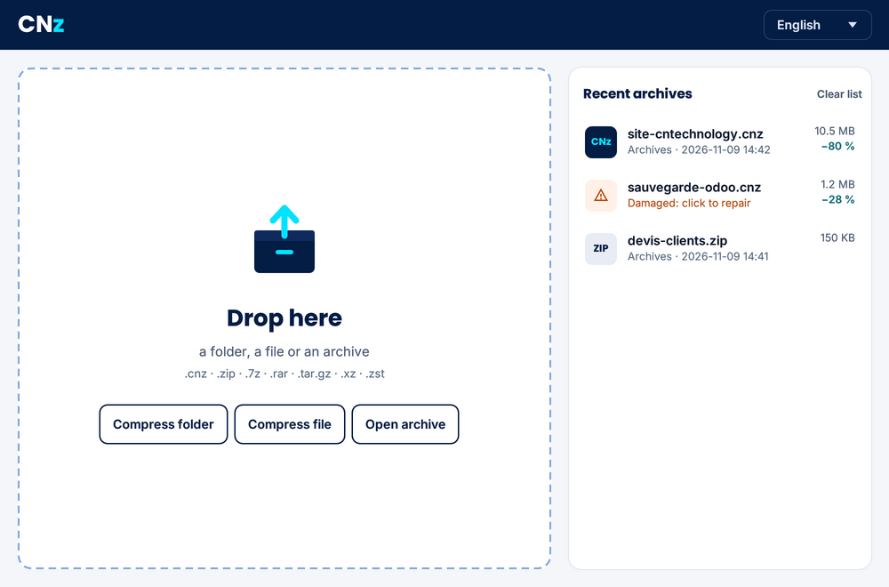
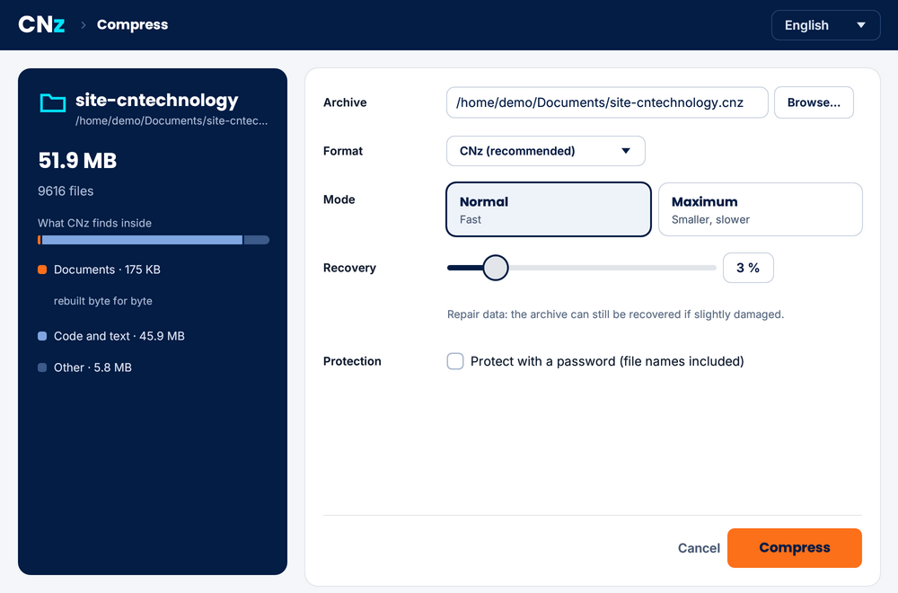
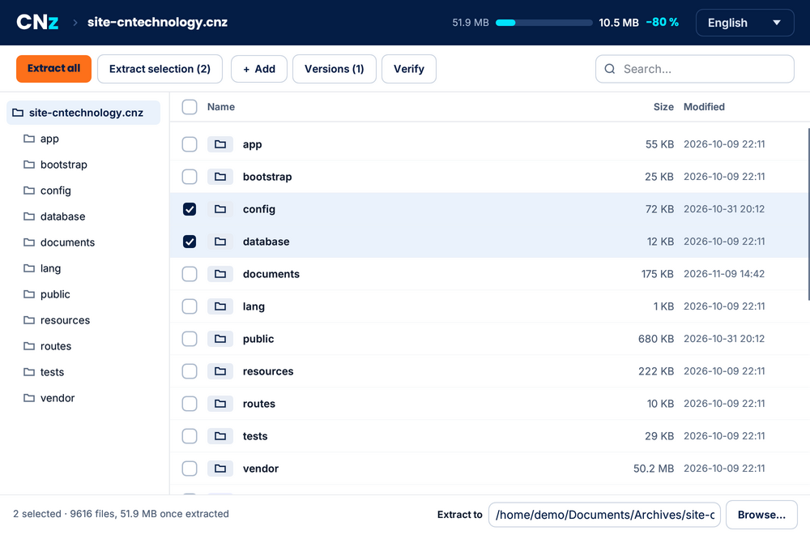

# CNz

**Free file compression and extraction.** Archives smaller than 7-Zip on photos and documents, repairable when damaged, encrypted if you want.

[Version française](README.md)



CNz is free and open-source software from [CN Technology](https://cntechnology.fr), a small company in Belfort, France. It creates `.cnz` archives and also opens the common formats: ZIP, 7z, RAR, tar, gz, bz2, xz and zst.

## What it does

- **Smaller archives.** CNz picks the right method for each file type. It recompresses JPEG photos losslessly, making them about 20% smaller. It also rebuilds Office documents and PNG images to compress them better, then gives you back exactly the same bytes.
- **Repairable archives.** By default, 3% recovery data: a file damaged on a disk, a USB stick or a download can be repaired (`cnz reparer`).
- **Serious encryption.** XChaCha20-Poly1305 and Argon2id. File names are encrypted too.
- **History.** Add files to an archive without recompressing everything, see what changed between versions and restore an older one.
- **An archive explorer.** Folder tree, search, tick boxes: extract everything or just what you picked, in ZIP, 7z and RAR files too.
- **For people without CNz.** Name the archive `.zip`, `.7z` or `.tar.gz` and it is created in that format.
- **Fast.** It uses every processor core. On 240 MB of website source code, it compresses in 31 s (7-Zip ultra: 46 s) and extracts in 2.4 s (7-Zip: 2.8 s).
- **A maximum mode** that saves another 10 to 13% on text and code. This mode is slower (about 1 MB/s per core).

## Comparison

Real data sets measured in October 2026 on a 4-core laptop. The percentage gives the archive size relative to the original: the smaller, the better.

| | CNz | 7-Zip 25 ultra | zstd 19 |
|---|---|---|---|
| JPEG photos (418 MB) | **78.8%** | 98.8% | 98.8% |
| Office documents (17 MB) | **52.1%** | 60.3% | 68.9% |
| PNG images (34 MB) | **69.4%** | 74.4% | 74.7% |
| Website source code (240 MB) | **27.0%** | 28.4% | 34.6% |
| Same code, maximum mode | **23.5%** | | |

The code row includes CNz's 3% recovery data; the other rows are measured without recovery data, for a like-for-like comparison.

## Install

**Windows**: download `CNz-installation-….exe` from the [releases](../../releases). Installation needs no administrator rights and adds CNz to the Start menu and the right-click menu: compress, compress to ZIP, extract here.

**Linux and macOS**: build CNz from source (see below). You can then add CNz to the right-click menu with `cnz menu installer` (Nautilus, Dolphin, Nemo).

## Use

The window is simple: drop a folder, a file or an archive. It is translated into 20 languages. The home screen keeps your recent archives; a damaged one is flagged there and repaired in one click.





The command-line messages are in French for now. Commands:

| Command | Purpose |
|---|---|
| `cnz c archive.cnz folder` | compress (`-p` to encrypt, `-r N` for N% recovery data, `--maximum`) |
| `cnz c archive.zip folder` | create a ZIP (or .7z, .tar.gz, .tar.xz…) |
| `cnz x archive.cnz [folder]` | extract a .cnz, .zip, .7z, .rar, .tar.gz… archive |
| `cnz l archive.cnz` | list the contents (`--versions` for the history) |
| `cnz t archive.cnz` | check, and say whether the archive can be repaired |
| `cnz a archive.cnz files` | add files without recompressing everything |
| `cnz reparer archive.cnz` | repair a damaged archive |
| `cnz menu installer` | add CNz to the right-click menu (`desinstaller` to remove it) |

In scripts, the `CNZ_MOT_DE_PASSE` environment variable supplies the password.

## Build

You need [Rust](https://rustup.rs) (stable, 1.89 or later) and a C compiler: CNz bundles zlib and zstd. The RAR reader ([rars](https://github.com/bitplane/rars)) is written in Rust, like the rest.

```sh
cargo build --release                         # command line: target/release/cnz
cd fenetre && cargo build --release           # window: fenetre/target/release/cnz-fenetre
cargo test --release                          # tests
```

`cargo build --no-default-features` builds CNz without the RAR reader.

## Format

The `.cnz` format is described in [SPEC.md](SPEC.md) (French version: [SPEC.fr.md](SPEC.fr.md)). In short:
- independent blocks compressed by zstd, or by the maximum-mode engine;
- a BLAKE3 hash for every chunk;
- an index kept as a version journal;
- Reed-Solomon recovery data and backup copies of the index.

The format is frozen at version 1: future versions of CNz will always open today's archives.

## Author

CNz is developed by [CN Technology](https://cntechnology.fr) in Belfort, France, with the help of AI tools. Code comments are in English; the format specification is available in English and French. Command-line messages are in French for now.

## License

CNz is dual-licensed under [MIT](LICENSE-MIT) or [Apache 2.0](LICENSE-APACHE), at your option. Third-party components (zlib, rars RAR reader, built-in dictionary, fonts) are listed in [NOTICE](NOTICE). The RAR reader is only used for extraction: CNz does not create RAR files.
