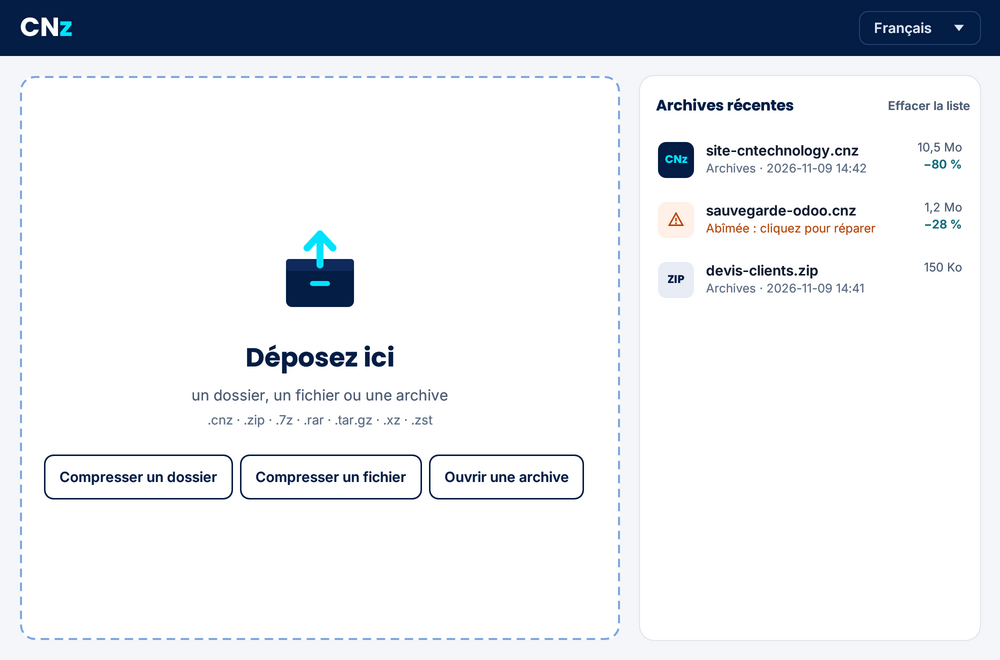
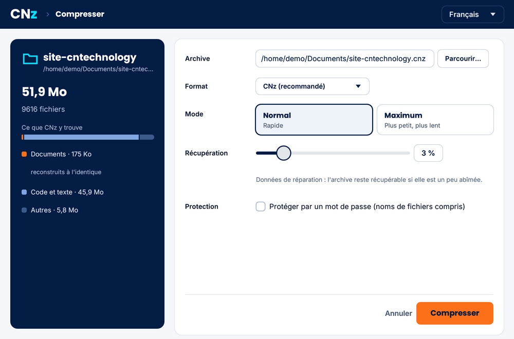
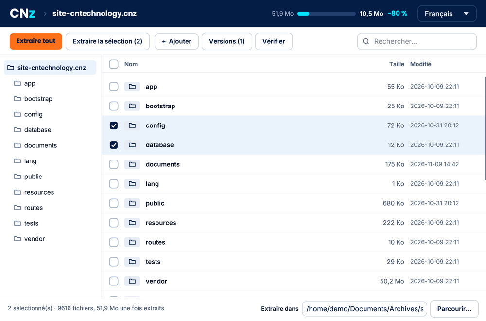

# CNz

**Compresser et extraire des fichiers, gratuitement.** Archives plus petites que 7-Zip sur les photos et les documents, réparables quand elles sont abîmées, chiffrées si vous le voulez.

[English version](README.en.md)



CNz est un logiciel libre de [CN Technology](https://cntechnology.fr), une petite entreprise de Belfort. Il crée des archives `.cnz` et ouvre aussi les formats courants : ZIP, 7z, RAR, tar, gz, bz2, xz, zst.

## Ce qu'il fait

- **Des archives plus petites.** CNz choisit la bonne méthode pour chaque type de fichier. Il recompresse les photos JPEG sans aucune perte, environ 20 % plus petites. Il reconstruit aussi les documents Office et les images PNG pour mieux les compresser, et vous rend ensuite exactement les mêmes octets.
- **Des archives réparables.** Par défaut, 3 % de données de récupération : un fichier abîmé sur un disque, une clé USB ou en téléchargement peut être réparé (`cnz reparer`).
- **Un chiffrement sérieux.** XChaCha20-Poly1305 et Argon2id. Les noms des fichiers sont chiffrés eux aussi.
- **Un historique.** On peut ajouter des fichiers à une archive sans tout recompresser, voir ce qui a changé d'une version à l'autre et restaurer une ancienne version.
- **Un explorateur d'archive.** Arbre des dossiers, recherche, fichiers à cocher : on extrait tout ou seulement ce qu'on a choisi, y compris dans un ZIP, un 7z ou un RAR.
- **Pour ceux qui n'ont pas CNz.** Nommez l'archive en `.zip`, `.7z` ou `.tar.gz` : elle est créée dans ce format.
- **Rapide.** Il utilise tous les cœurs du processeur. Sur le code d'un site web de 240 Mo, il compresse en 31 s (7-Zip ultra : 46 s) et extrait en 2,4 s (7-Zip : 2,8 s).
- **Un mode maximum** pour gagner encore 10 à 13 % sur le texte et le code. Ce mode est plus lent (environ 1 Mo/s par cœur).

## Comparaison

Volumes réels mesurés en octobre 2026 sur un portable à 4 cœurs. Le pourcentage donne la taille de l'archive par rapport à l'original : plus il est petit, mieux c'est.

| | CNz | 7-Zip 25 ultra | zstd 19 |
|---|---|---|---|
| Photos JPEG (418 Mo) | **78,8 %** | 98,8 % | 98,8 % |
| Documents Office (17 Mo) | **52,1 %** | 60,3 % | 68,9 % |
| Images PNG (34 Mo) | **69,4 %** | 74,4 % | 74,7 % |
| Code d'un site web (240 Mo) | **27,0 %** | 28,4 % | 34,6 % |
| Même code, mode maximum | **23,5 %** | | |

La ligne du code compte les 3 % de récupération de CNz ; les autres lignes sont mesurées sans récupération, à armes égales.

## Installer

**Windows** : téléchargez `CNz-installation-….exe` dans les [versions publiées](../../releases). L'installation ne demande pas de droits d'administrateur et ajoute CNz au menu Démarrer et au clic droit : « Compresser avec CNz », « Compresser en ZIP », « Extraire ici ».

**Linux et macOS** : compilez CNz depuis le code source (voir plus bas). Vous pouvez ensuite ajouter CNz au clic droit avec `cnz menu installer` (Nautilus, Dolphin, Nemo).

## Utiliser

La fenêtre est simple : on dépose un dossier, un fichier ou une archive. Elle est traduite en 20 langues. L'accueil garde la liste des dernières archives ; une archive abîmée s'y signale et se répare en un clic.





En ligne de commande :

| Commande | Rôle |
|---|---|
| `cnz c archive.cnz dossier` | compresser (`-p` pour chiffrer, `-r N` pour N % de récupération, `--maximum`) |
| `cnz c archive.zip dossier` | créer un ZIP (ou .7z, .tar.gz, .tar.xz…) |
| `cnz x archive.cnz [dossier]` | extraire une archive .cnz, .zip, .7z, .rar, .tar.gz… |
| `cnz l archive.cnz` | lister le contenu (`--versions` pour l'historique) |
| `cnz t archive.cnz` | vérifier, et dire si l'archive est réparable |
| `cnz a archive.cnz fichiers` | ajouter des fichiers sans tout recompresser |
| `cnz reparer archive.cnz` | réparer une archive abîmée |
| `cnz menu installer` | ajouter CNz au clic droit (`desinstaller` pour l'enlever) |

Pour les scripts, la variable `CNZ_MOT_DE_PASSE` donne le mot de passe sans le taper. Les messages de la ligne de commande sont pour l'instant en français.

## Compiler

Il faut [Rust](https://rustup.rs) (version stable, 1.89 ou plus) et un compilateur C : CNz embarque zlib et zstd. Le lecteur RAR ([rars](https://github.com/bitplane/rars)) est écrit en Rust, comme le reste.

```sh
cargo build --release                         # ligne de commande : target/release/cnz
cd fenetre && cargo build --release           # fenêtre : fenetre/target/release/cnz-fenetre
cargo test --release                          # tests
```

`cargo build --no-default-features` compile CNz sans le lecteur RAR.

## Le format

Le format `.cnz` est décrit dans [SPEC.fr.md](SPEC.fr.md) (version de référence en anglais : [SPEC.md](SPEC.md)). En résumé :
- des blocs indépendants compressés par zstd, ou par le moteur du mode maximum ;
- une empreinte BLAKE3 pour chaque morceau ;
- un index en journal de versions ;
- des données de récupération Reed-Solomon et des copies de secours de l'index.

Le format est figé en version 1 : les futures versions de CNz ouvriront toujours les archives d'aujourd'hui.

## Auteur

CNz est développé par [CN Technology](https://cntechnology.fr), à Belfort, avec l'aide d'outils d'intelligence artificielle. Les commentaires du code sont en anglais ; la spécification du format existe en anglais et en français.

## Licence

CNz est sous double licence [MIT](LICENSE-MIT) ou [Apache 2.0](LICENSE-APACHE), au choix. Les composants tiers (zlib, lecteur RAR rars, dictionnaire intégré, polices) sont listés dans [NOTICE](NOTICE). Le lecteur RAR sert uniquement à extraire : CNz ne crée pas de fichiers RAR.
